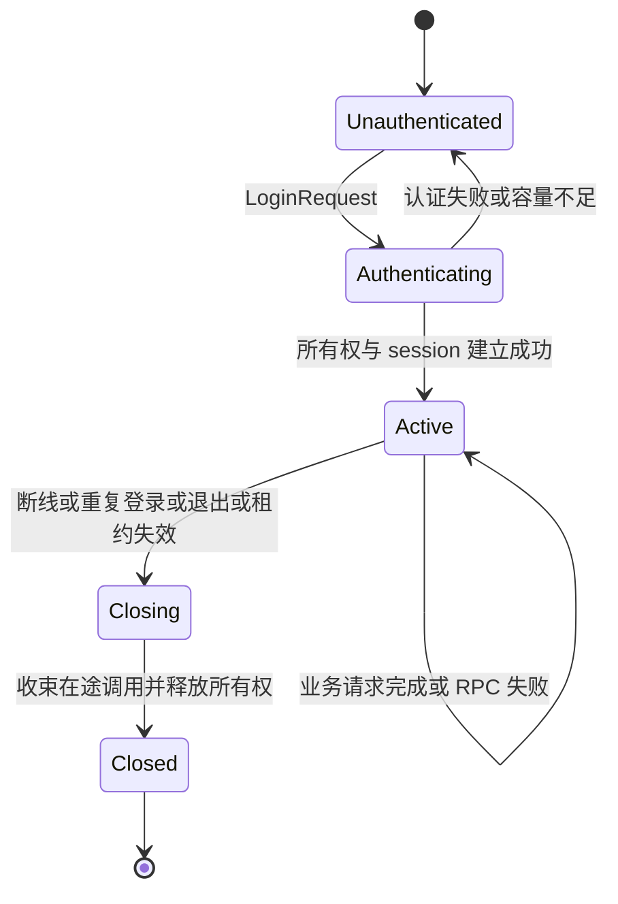

# 局外 TCP 协议与 session 实施约定

## 第二批目标与边界

本节至“验收与交付”记录第二批协议基线，第三批第二步记录版本 2 基线；当前实现以文末“第三批第四步：跨网关交接”和 Rust 用户指南为准，客户端帧已升级为版本 3。已补充 Redis 开发发现、共享所有权、在线 timer 调度、ACK 缓存及同网关恢复，可独立配置 ownership=redis；普通登录仍不能抢占其他网关的活动租约；共享签名密钥及交接端点显式启用后支持跨网关接续。默认断线保留 session 30 秒。超时及存储尽力保护遵循设计文档的系统异常边界，不承诺绝对互斥。

第二批实现单进程开发链路：客户端通过 TCP 登录，认证扩展点返回可信 player id，网关取得内存所有权并建立串行 session，业务请求通过内部 RPC 调用 player，Response 返回客户端。示例提供状态读取、状态变更和 player 调用 guild，并用真实 TCP 客户端验收。

本批采用开发环境明文 TCP；认证逻辑由游戏注入，示例凭证只适用于本地开发。生产安全与内部调用认证按后续阶段实施。断线后立即关闭 session，停止新任务，收束已开始的 RPC 后条件释放所有权；第三批已实现在线 timer、server_seq、ack_seq 与有界缓存，断线宽限期、补发、resume_token 和跨网关交接仍待实现。

## TCP 分帧与消息

每帧由 4 字节大端无符号长度和 protobuf Frame 正文组成。长度只计算正文，必须大于零且不超过 max_frame_size；在分配正文缓冲区前检查长度。读取整个帧及写入整个帧都有期限，包含等待首字节的空闲时间；半帧 EOF、非法长度、解码失败和版本不匹配会终止连接。本批没有独立心跳帧。

Frame 使用版本 1，通过 oneof 区分 LoginRequest、LoginResponse、BusinessRequest、BusinessResponse、Notify 和 ControlError。客户端只发送登录和业务请求；不接受客户端伪造的回应、通知或控制错误。

| 消息 | 字段与用途 |
| --- | --- |
| LoginRequest | request_id、credential；凭证仅交认证扩展点，不记录日志 |
| LoginResponse | request_id、error_code、成功时的 player_id、session_id、epoch |
| BusinessRequest | request_id、message_id、body；玩家身份来自绑定 session |
| BusinessResponse | request_id、message_id、error_code、body；成功时使用注册的回应 ID，框架失败时使用原请求 ID，正文为空 |
| Notify | message_id、body；保留有界下行入口，尚无补发序号 |
| ControlError | request_id、error_code；表示无法按正常登录或业务回应处理的控制错误 |

每条连接的请求 ID 必须非零且严格递增，登录与业务请求共用这个约束。重复或倒退的 ID 返回 InvalidRequest，不重新执行业务；客户端不能依赖自动重试获取未知结果。message_id 必须非零，具体游戏 protobuf 及请求回应配对由游戏注册。

登录控制流程负责认证和会话建立；游戏初始状态通过登录后的业务请求读取。本批不将 SDK 鉴权或 timer 安装固化到通用 TCP 登录协议中。

## 连接与会话状态

Connection 是一个传输连接，session 是一个逻辑执行入口。未认证连接不能执行 player 业务；已绑定连接再次发送 LoginRequest 返回 InvalidState。重复登录使用新连接与认证凭证，不把旧 session 的身份直接交给客户端恢复。

同一 player 的重复登录按玩家范围协调：先取消旧连接与旧 session 的新任务入口，等待其已开始的调用结束或超时，再条件释放旧所有权并建立新 session_id 与 epoch。旧队列中尚未开始的任务失效，不转移给新 session；只有新连接能继续提交有效业务。不同玩家的登录和执行可以并发。

第二批只允许接管本进程维护的旧 session。发现另一个网关的所有权时返回 Unavailable，跨网关接管须等交接协议实现。所有权比较、续租和释放通过 OwnershipStore 契约，网关不直接依赖内存或 Redis 实现。

## 串行执行与资源控制

认证成功后，每个 player 使用独立的有界队列和一个执行任务。客户端请求进入此队列；后续 timer 和转发事件也使用同一执行入口。每次执行前检查会话活动状态并条件续租，不允许失效身份继续开启调用。

网关由 Executor 契约调用 player；默认 RPC 适配器按可信 player id 选点并构造 CallContext。普通广播或主动 Notify 使用有界下行入口，不调用 player。RPC 调用和任意注入执行器均受调用期限控制，不自动重试；超时后远端 handler 可能仍在运行，沿用总体设计已接受的异常边界。

连接任务、session 任务和等待回应的任务必须受监督。退出时停止接收连接，取消活动 session，等待在途调用与条件释放；任务崩溃触发网关运行失败，交由 Application 清理。连接和 session 的容量、队列、帧长度及期限均有限。

| 参数 | 开发默认值 | 行为 |
| --- | --- | --- |
| max_connections | 128 | 连接容量满时关闭新连接 |
| max_sessions | 1024 | session 容量满时登录失败，关闭的记录可回收 |
| queue_capacity | 64 | 已在执行的任务之外最多等待的业务数，满时返回 QueueFull |
| outbound_capacity | 64 | 下行缓冲满时关闭慢连接 |
| max_frame_size | 1048576 字节 | 读写正文最大长度 |
| io_timeout_ms | 15000 | 单次完整帧读写期限 |
| auth_timeout_ms | 5000 | 认证扩展点执行期限 |
| rpc_timeout_ms | 5000 | player 业务调用期限 |
| ownership_ttl_ms | 30000 | 内存开发所有权的租期 |
| renew_interval_ms | 10000 | session 空闲时的续租间隔 |

配置验证要求所有值为正且具有合理上限；租期必须覆盖续租间隔与调用期限。本批默认值用于开发验收，不构成吞吐或生产容量承诺。

## 客户端错误与扩展点

框架定义成功、参数无效、未登录、认证失败、队列满、会话失效、服务不可用、调用超时、系统错误、状态无效、帧过大、未知消息、会话被替换和 session 容量不足等有限错误码。业务 RpcError 的非零错误码由游戏维护，普通业务成功回应仍由游戏的 protobuf 定义。

认证失败返回 LoginResponse；业务失败返回对应 request_id 的 BusinessResponse；无法关联或非法控制消息返回 ControlError 后按协议错误关闭连接。认证凭证、协议正文和 token 不进入框架日志。RPC Status 到客户端错误码通过可注入映射器转换；业务不可用与调用超时必须明确区分。

## 验收与交付

- 真实 TCP 客户端完成登录、状态读取、状态变更和公会查询；业务数据以 session 的可信 player id 为准。
- 同一玩家多个排队请求保持串行，不同玩家能够并发；队列满时快速返回 QueueFull，不能积压无界任务。
- 验证登录失败、未认证请求、未知消息、非法正文、重复 ID、错误版本、半帧、超限帧、慢连接与 RPC 超时；失败不能导致自动重试。
- 验证重复登录、新旧连接失效边界、旧任务拒绝、租约丢失、断线释放及网关退出，无脱管连接或 session 任务。
- 通过格式、clippy、missing_docs、测试、rustdoc、内部 RPC smoke 与新增客户端 smoke；同步更新实现状态和用户指南。

校准文档单独提交。第二批实现、测试和文档更新经用户审阅后独立提交。

## 第三批第二步：下行序列、确认与缓存

2026-10-19 校准并实施。本节保留版本 2 的交付基线，描述在线 session 的统一下行序列、累计确认和有界内存缓存；其中断线即关闭和版本限制已由文末第三步扩展为版本 3 的恢复流程。

### 协议与序号范围

Frame.version 已升为 2，保留现有消息字段编号，在 BusinessResponse 和 Notify 增加 uint64 server_seq，并增加独立的 Ack 控制消息，内容为 uint64 ack_seq。客户端和 demo 同步升级；服务端只接受版本 2，明确拒绝版本 1，不同时维护两套会话语义。protobuf 包名与字段兼容性不代表客户端会话语义兼容。

| 消息或结果 | 是否进入下行序列与缓存 |
| --- | --- |
| 已绑定 session 的 BusinessResponse | 是，包含成功、业务错误及 QueueFull、InvalidRequest、RPC 超时等框架失败 |
| 已绑定 session 的 Notify | 是，与 BusinessResponse 共用序列 |
| LoginResponse、ControlError、Ack | 否，登录、协议错误与确认属于连接控制流程 |
| 内部 player RPC 结果、timer 执行结果 | 本身不进入；只有实际向游戏客户端发布的 Response 或 Notify 才进入 |

未绑定 session 的业务请求改用 ControlError 返回 Unauthenticated 或请求校验错误，不能产生 server_seq 为零的 BusinessResponse。登录失败仍使用 LoginResponse。已绑定 session 后的非法控制帧或非法 ACK 使用 ControlError 并关闭连接；此类错误不伪装成业务回应。

每个逻辑 session 从 server_seq=1 开始，逐条递增；0 表示尚无消息。达到 uint64 上限时停止该 session，不回绕。新登录和重复登录创建新 session，重新从 1 开始。未来恢复原 session 时才保留原序号。

request_id 继续关联请求与回应，并遵守现有每连接非零、严格递增的检查；message_id 继续标识业务消息类型。server_seq 按下行发布顺序分配，不按 request_id 排序：较晚请求的 QueueFull 回应可以先于较早请求的在途 RPC 回应发布。TCP 保证单条连接上的字节有序，逻辑 session 的序号用于确认和未来跨连接补发，两者职责不同。

### 统一发布与发送边界

所有面向游戏客户端的 Response 和 Notify，包括业务执行器结果、主动通知和连接读侧产生的业务拒绝，都通过同一个 session 下行入口。每个 session 在此入口串行完成尺寸检查、分配序号、编码、缓存提交及按序加入发送队列；不能在各个发送源或 socket writer 中分别分配序号。主动通知无需进入 player 业务执行队列，也不等待在途 RPC 完成。

帧大小按包含版本、序号等字段的最终 protobuf Frame 正文判断。超大 Response 在提交前转换为空正文的 FrameTooLarge 回应，保留 request_id，使用原请求 message_id；超大 Notify 在分配序号前拒绝。若最小错误回应仍无法容纳，则关闭 session。缓存提交后的字节不可再由 writer 修改；同一帧的缓存内容与写出的正文必须一致。

缓存保存完整 protobuf Frame 正文，不含 TCP 的 4 字节长度前缀，也不含连接专属加密封装。字节容量按实际编码长度计数。未来补发使用原编码字节和原序号，由新连接重新添加传输封装，不重新编码业务结果、不重新调用 player。

发布入口先提交缓存，再尝试向有界发送队列提交；序号分配、缓存与入队的临界区不等待网络 I/O。缓存一经提交即属于已发布下行，即使随后入队失败也不回收或复用序号。发送队列满或关闭时沿用当前关闭 session 的行为，本步不保留可恢复的离线 session。登录成功回应须先进入同一连接的发送队列，再开放该 session 的业务下行。

发布成功仅表示缓存与发送队列接收，不表示 socket 已写完；本地写入完成的 oneshot 通知也不表示客户端处理完成。客户端处理完成只能由 ACK 表达。

### 累计确认

客户端必须按 server_seq 连续应用业务状态，再报告已处理完成的最大序号 ack_seq。例如已处理 1、2、4 而缺少 3 时，只能确认 2；重复收到不大于已处理位置的消息时忽略其业务内容。本步只使用独立 Ack，不在 BusinessRequest 上同时增加确认字段；Ack 不消耗 request_id，不进入 player 队列，也不触发 RPC。

服务端将 Ack 关联到当前连接绑定的 session，不接受客户端指定其他 session。确认位置初始为 0；ack_seq 为 0、重复值或低于已确认位置时忽略，高于该 session 已发布的最大 server_seq 时属于 InvalidRequest。合法前进的 ACK 更新确认位置并释放不大于该位置的缓存。未认证连接发送 Ack 时返回 ControlError（Unauthenticated）并关闭连接。

ACK 上界使用已提交缓存的最大发布序号，不使用 socket 写入完成位置，避免读侧先收到合法 ACK、写侧尚未记录完成的竞争。ACK 是客户端对自身处理进度的声明，服务端只做范围检查，不证明客户端确实执行了业务状态更新。未来重绑定连接时，还必须拒绝已失效连接对原 session 的发布与确认。

### 缓存限制与可补发范围

每个 session 独立配置 replay_ttl_ms、replay_capacity 和 replay_max_bytes，分别限制消息原始发布时间后的保留时长、条数及编码字节总量。开发默认值为 30000 毫秒、256 条和 4194304 字节；上限分别为 86400000 毫秒、65536 条和 64 MiB，均须为正，replay_max_bytes 不得小于 max_frame_size。限制属于每个 session，实际占用随消息增长，不能把单会话字节上限当作整个网关的内存预算。

时间使用本地单调时钟。过期、条数超限或字节超限均从最旧记录开始淘汰，包含未确认消息；不能为等待 ACK 无限保留。重发不刷新原始发布时间。清理可以在发布、ACK 和读取缓存时进行，无需为每条消息创建定时任务；会话关闭时释放全部缓存。

维护已发布最大序号和已移除记录的最大序号，后者作为可补发下界，初始为 0。ACK 释放及容量、时间淘汰均更新该下界。未来请求从客户端确认位置 a 恢复时，只有 a 不小于下界、不大于已发布最大序号，且 (a, 最大序号] 的记录完整连续，才能补发；否则返回 ResumeUnavailable。客户端报告的位置比服务端已释放的确认位置更早，也不能通过静默跳号或重执行请求来修复。

例如已发布到 10，缓存仅保留 6..10：客户端确认 5 时可补发 6..10，确认 4 时无法补发，确认 10 时无需补发。在线期间淘汰未确认消息不立即关闭 session；若客户端之后确认到被淘汰范围之后，可补发范围随之推进，不将 session 永久标记为不可恢复。

本步只实现缓存范围查询及缺口判断，不增加 Resume 请求、resume_token 或对外 ResumeUnavailable 流程。缓存淘汰不改变已执行的业务，也不触发补偿、重试或回滚；request_id 与 ACK 均不提供请求幂等或恰好一次执行保证。

SessionHandle::replay_after 返回查询时的最大序号与连续编码正文快照，缺口或越界返回 None，关闭后返回 SessionClosed；查询不发送或确认消息。快照与缓存共享字节，调用方须及时释放，避免在缓存淘汰后继续持有内存。try_request 的独立结果只交给调用方，不自动发布、不消耗下行序号。

### 实施与验收顺序

1. 扩展版本 2 协议及中文文档，明确上行 Ack、下行业务序号与控制帧方向；更新 demo 客户端的按序处理及确认。
2. 实现 session 下行发布与缓存，将正常回应、拒绝回应和通知统一接入；writer 仅发送已经确定的帧字节。
3. 实现 ACK 校验、缓存释放及范围查询，继续保持断线立即关闭和现有 timer 行为。
4. 通过常规检查与真实 TCP smoke，同步更新 Rust 用户指南中的版本、错误处理和能力边界。

验收须覆盖 Response 与 Notify 交错、队列拒绝与 RPC 回应并发、序号连续递增且无重复、控制帧不占序号、未认证 ACK、确认零值及重复/倒退/越界、ACK 与写入完成竞争、超大帧转换后缓存与发送一致。使用可控时钟验证过期、条数和字节边界、确认释放、淘汰缺口及后续 ACK 推进；验证慢连接、关闭和重复登录能回收缓存，不增加业务执行次数。

第二步验收通过后再实现同网关恢复：分离连接与 session 生命周期，加入宽限期、token、重绑定、补发与新消息排序、恢复完成标记及快速重登。届时补充连接代次和恢复期间 ACK 的约束，不能仅靠已有缓存宣称支持重连。

本步 Windows 验收已通过：88 项常规测试、4 项文档测试、格式、clippy、rustdoc、三类本地 smoke、两项 Redis 多进程 smoke 和 release 构建；详细记录见实施大纲。代码与协议已按本节实现，恢复流程留待下一步。

## 第三批第三步：同网关恢复

### 版本、凭证与资源限制

客户端 Frame.version 升级为 3，保留已有 protobuf 字段编号，只接受版本 3；protobuf 包名仍为 tok.client.v1。LoginResponse 新增 resume_token 与 resume_token_ttl_ms；LoginRequest 新增 resume_token，与 credential 二选一。新增 ResumeRequest、ResumeResponse 和 RecoveryComplete 三类控制消息，它们不占 server_seq，不进入业务执行队列。

当前凭证改用固定共享密钥的 HMAC-SHA256 认证，含 player_id、session_id、签发/过期时间。客户端将其视为不透明字符串，长度上限 4096 字节，不固定为 64 字符。临时密钥默认仅本进程有效，跨网关显式配置相同密钥；具体凭证与顶号约束见第四步。

| 参数 | 默认值 | 边界 |
| --- | --- | --- |
| disconnect_grace_ms | 30000 | 0..86400000；0 保留断线即关闭行为 |
| resume_token_ttl_ms | 3600000 | 1..86400000，独立于 session 恢复窗口 |

token 到期不主动踢出仍在线的 session，但之后不能使用该 token 恢复或快速重登。恢复不刷新 token 的原始期限。不维护凭证容量表；新登录更新最新 session_id，旧 token 即使签名未过期也不再具备会话接入资格。

### 断线与重绑定

服务器观察到 EOF、读写超时、传输失败或下行队列满时，只解除当前连接绑定并开始宽限期；session 保留租约、已排队/在途请求、timer 和下行缓存，继续串行执行并续租。期间下行只写入原有有界缓存；缓存淘汰规则保持不变。宽限期到期、显式关闭、非法协议、租约失效或网关退出才停止 session，收束在途调用后条件释放所有权。

每个 session 的受监督运行包含独立宽限期 future，避免在途 RPC 延迟超时判定，不为每次断线启动新任务。完整帧读写期限仍包含空闲时间，当前没有心跳；宽限期从服务器实际观察到断线开始。

客户端在新连接发送 ResumeRequest { request_id, resume_token, ack_seq }。校验 token、原 session、租约与缓存范围后，保持原 session_id、epoch 和下行序列，分配新的内部连接代次并失效旧连接。请求提交、ACK、读侧失败回应和断线清理均比较代次，旧连接晚到的动作不能影响新绑定。成功绑定撤销旧宽限期，之后再次断线才开始新宽限期。

### 补发与请求接续

成功恢复先发送 ResumeResponse，携带原身份和 last_request_id，再补发 ack_seq 之后的原始缓存正文。补发期间产生的新下行先缓存，由同一写循环按序追上。追平时提交 RecoveryComplete { through_seq }，之后才进入普通下行发送；新消息不能越过完成标记。客户端收到标记后恢复普通交互。

读循环与补发写循环独立运行，客户端可以在补发过程中累计 ACK；提前提交新业务返回 InvalidState。ACK 范围仍以最大发布序号为上界，恢复确认不能高于该值；低于已释放或淘汰下界的恢复位置返回 ResumeUnavailable，不能静默跳号。整个补发过程受 io_timeout_ms 限制。补发期间又出现缓存缺口时，返回 ControlError(ResumeUnavailable) 并断开新连接，不发送成功标记；客户端即使收到部分补发也应走状态重同步。

last_request_id 保存网关已见过的最大业务请求 ID，包含队列拒绝等失败；新请求必须大于本地已发送最大值与服务端报告值，不能在恢复后重置计数或自动重发未知结果请求。已执行或排队请求不因重连再次执行。在途调用可以在恢复完成标记之后才产生回应，仍按原 request_id 与同一 session 下行序列发布。

### 恢复失败与快速重登

token 有效但会话过期、缓存有缺口或无法继续原所有权时，ResumeResponse 返回 ResumeUnavailable。客户端可在同一未绑定连接用 LoginRequest.resume_token 快速重登，绕过游戏认证器；按普通登录的协调流程关闭旧入口、收束调用、获取所有权并创建新 session、epoch 和 token，序号从 1 开始。无效或过期 token 返回 AuthenticationFailed，改走普通 credential 鉴权。其他网关当前无法验证本地 token，不提供跨网关快速重登。

快速重登后游戏重新请求完整业务状态与 timerSpec，框架不增加固定的 player 登录 RPC。demo 将生产截止时间保存在服务端游戏状态，GetPlayer 返回完整状态和 TimerUpdate::ReplaceAll；新 session 可重装待完成 timer，已完成生产不会再次计奖。同网关恢复复用已有 timer，不重新安装。

验收覆盖断线期间 timer 与租约继续、宽限期到期及撤销、在途回应补发且不重执行、缓存缺口、失效 token、旧连接各类动作隔离、新下行不越过补发完成标记、快速重登重置序列及全量 timer 初始化。跨网关交接、网关重启后恢复原序列和持久化业务状态不属于本步。

本步 Windows 验收已通过：101 项常规测试、4 项文档测试、格式、clippy、rustdoc、三类本地 smoke、两项 Redis 多进程 smoke 与 release 构建。半帧 EOF 和底层读取中断按 SessionClosed 传输错误进入宽限期，完整帧的非法长度、版本或 protobuf 内容仍按协议错误终止会话；已补充对应恢复测试。

## 第三批第四步：跨网关交接

### 目标与实施边界

客户端携带原 resume_token 连接网关 B；原逻辑会话位于网关 A。A 可达、凭证有效、缓存连续且交接成功时，B 保留 session_id、request_id 进度和下行序列，取得新的所有权 epoch，接续 timer 并完成原字节补发。客户端仍使用 ResumeRequest、ResumeResponse 和 RecoveryComplete；成功回应中的 epoch 使用接管后的新值。

本步先交付客户端重连触发的交接，不实现主动连接迁移、网关宕机后的缓存恢复或持久化业务状态。Redis 只保存凭证和协调记录，不保存下行正文或 timer 快照。A 宕机时，凭证仍可用于身份验证，但原内存状态不可恢复，须等待原租约释放或过期，再快速重登并请求完整业务状态。

本节已接入实现；默认内存配置仍只支持签发网关内恢复，共享后端和交接能力显式开启。客户端协议字段无需新增；实现时继续检验版本 3 的兼容性，若实际字段或语义出现不兼容变化，单独记录版本调整。

### 在线凭证刷新

客户端 Frame 版本保持 3，新增 oneof 字段 12 RefreshResumeTokenRequest refresh_resume_token 和字段 13 RefreshResumeTokenResponse resume_token_refreshed，不改已有字段。
请求仅含 request_id，不携带旧 token；回应包含 request_id、error_code、resume_token、resume_token_ttl_ms，失败时凭证字段为空。两帧不占 server_seq、不缓存、不调用业务 RPC。request_id 为非零、在当前连接内递增，与登录、恢复及业务请求共用计数；它不更新“已见最大业务请求 ID”，客户端跨重连仍保存自身已发送最大 ID。

只有当前已认证且完成恢复的连接可刷新，旧 token 过期不影响在线刷新授权。刷新与顶号、交接经同一玩家协调门串行化；先确认当前 session 并条件续租，再在连接绑定锁内校验当前代次、非补发/冻结状态，签发并将回应入队。未登录返回 Unauthenticated；非法或重复 ID 返回 InvalidRequest；过时、关闭及失去所有权的入口不返回新 token，所有权续租失败会停用原 session。

新 token 保留原 session_id，从签发时重新计算有效期；不重建会话、重置 epoch/序号、改变 timer 或重新鉴权。旧 token 仍按原期限有效，刷新不引入逐 token 撤销表；新登录的 session_id 替换会同时阻止该旧会话的所有凭证再接入。恢复与交接本身仍不续期。

客户端在成功回应后替换保存的 token，并按返回 TTL 提前主动刷新，例如有效期经过约 80% 时发起，预留网络及调度余量。回应丢失时，在线连接可使用新的 request_id 重试；离线且 token 过期则走普通 credential 登录。刷新不是连接保活替代品，也不自动延长原会话的断线宽限期。无需额外的长期 refresh token 或运行时密钥刷新。

### 本地签名凭证与网关定位

ResumeTokenCodec 是同步的本地签发/验证契约，不允许读取 Redis、数据库或其他网络来源。SignedResumeTokens 使用固定共享密钥计算 HMAC-SHA256；验证时检查消息认证码、可信身份和绝对过期时刻，不维护逐 token 的服务端记录。凭证内容可解码，不提供加密保密。

多节点配置相同的固定共享密钥；默认单进程使用随机临时密钥。跨进程配置 `[resume_token]`，包含 secret_key 和可选 clock_skew_ms。secret_key 为 32 字节随机密钥的十六进制编码。密钥只在启动时加载，不提供公钥环、热替换或自动刷新；维护时统一更换密钥并重启所有参与网关，旧 token 失效，客户端需普通登录。

恢复、交接及验证均不延长过期时刻；clock_skew_ms 默认 5000，仅容忍签发时刻领先本机，不增加过期宽限。签名或期限不合法返回 AuthenticationFailed；本地密钥或时钟不可用按内部错误处理。客户端仍使用版本 3 和原 string 字段，无需解析 token 格式。

顶号保证不移除。新登录创建新 session_id、失效旧入口，并在获取所有权时原子更新每玩家最新登录会话标记。Resume 必须匹配当前原会话；快速重登通过 acquire_for_relogin 将签名中的原 session_id 与最新标记原子比较。交接保留标记，普通释放和租约过期不删除标记，旧 token 不能在新会话下线后再次建立会话。Redis 标记与持久 epoch 使用同一玩家 hash tag，不是逐 token 撤销表；验签本身完全不访问它。MemoryOwnership 保留有界的最近登录标记，历史被回收时快速重登保守拒绝，改走普通鉴权。

同一网关顶号先检查旧凭证是否属于当前会话，过时的快速重登请求不能先关闭新会话再发现不匹配；最终比较和新所有权获取仍在后端同一原子操作完成。签名有效但原 session 已替换时，Resume 返回 ResumeUnavailable，快速重登返回 SessionReplaced。维护时更换共享密钥并重启也能使旧凭证失效，但不代替会话协调。

B 校验凭证后通过 OwnershipStore.lookup 查找当前所有者，再按 owner.node_id 和 owner.service_name 从服务目录选择该网关的交接端点。发现记录只是地址，不能代替凭证和所有权校验。统一使用网关内部 GatewayRpc 服务，交接为其中一组方法，与普通 player 业务分发隔离；复用共享监听及显式端点绑定规则。调用携带完整预期所有权、目标所有者及唯一 handoff_id，A 核验当前本地会话和租约一致，拒绝过期身份及并发交接。

### 状态机与接管顺序

| 所在端 | 状态 | 允许的动作 |
| --- | --- | --- |
| A | Running | 正常接收业务、通知及 timer 触发 |
| A | Draining | 停止新准入及 timer 调度，排空已接收任务，继续续租 |
| A | Frozen | 快照已封存，不执行新业务、不发布下行，等待接管或取消 |
| B | Prepared | 快照已校验并预留容量，尚不驱动 player、timer 或业务下行 |
| B | Running | 条件接管成功，按恢复流程绑定连接、补发并继续执行 |
| A | Retired | 所有权已变化，入口永久失效，只做条件清理 |

1. B 完成凭证、恢复位置初检和本地连接/session 容量预留，创建 handoff_id，向 A 请求准备交接。同一玩家的新建、同网关恢复和交接必须经同一协调入口串行化。
2. A 进入 Draining，解除旧连接绑定并停止 timer 产生新票据；阻止连接请求、SessionHandle 提交、主动通知和后续恢复重新进入。不能调用会销毁缓存的普通 close 来代替暂停。已成功进入有界队列的请求和 timer 按原顺序处理，在途调用按既有 RPC 期限收束；返回的 timer 更新正常应用。
3. 排空后 A 在一致状态下封存快照，进入 Frozen，按最终缓存下界及上界重新检查 ack_seq。A 在所有权未转移且交接未过期时继续续租。快照返回 B，A 保留原快照和有限交接记录，供同一 handoff_id 查询状态。
4. B 完整校验快照、实际编码大小、缓存连续性和 timer 配置，预留缓存、队列和受监督任务容量后进入 Prepared。此时不能执行任何 player 调用或 timer。资源不足必须在改变所有权前返回错误。
5. B 向 A 提交相同 handoff_id 及快照标识。A 在该交接状态下串行判定提交与取消，提交开始后保持冻结并代表 B 执行原子条件转移：比较完整旧 SessionOwnership（含 player_id、session_id、owner 和 epoch）且租约未过期，保留 session_id、增加 epoch 并更新 owner。为 OwnershipStore 增加明确的条件转移契约，B 不旁路 A 直接接管。不同目标网关竞争时至多一个正常成功。
6. B 持新所有权安装快照并启动受监督会话，发送 ResumeResponse，再按原编码和序号补发，最后发送 RecoveryComplete。补发期间新下行保持现有缓存追平规则，新客户端业务仍需等待完成标记。
7. B 通知 A 完成交接；A 根据所有权已变更进入 Retired，条件清理原入口及快照。完成通知丢失不阻止 B 运行，A 通过续租失败或有界状态检查收束，不能释放 B 的租约或影响仍有效的签名凭证。

### 快照与交接期间的新工作

快照包含格式版本、handoff_id、原完整所有权、已见最大 request_id、执行侧请求进度、内部 timer 调用序号、下行最大发布序号、累计确认位置、补发下界，以及连续缓存的原始编码正文与剩余保留预算。缓存过期和原断线宽限期不得因交接重置；快照描述剩余时间而非跨进程传输 Instant，B 扣除本地测得的整个准备往返耗时作为保守预算，过期内容按原规则淘汰后再次校验连续性。转移时间造成缺口时恢复失败，不静默跳号。

timer 快照包含当前 spec、调度版本和下一次 scheduled_at_ms。Draining 排空已接收的 timer 后，Frozen 不保留排队票据或执行中的任务；B 重建本地队列和单调时钟等待，不能反序列化 future、Sender、连接绑定或 Instant。已完成的一次性 timer 不迁移；周期保留原预定时刻基准，交接期间错过周期仍合并为一次。跨节点时钟偏差沿用部署侧时间同步约定，不新增历史周期逐次补跑。

已准入请求必须在封存前完成本地收束并发布其结果，不迁移半执行的 Job。RPC 超时后远端可能继续运行，快照只保留本地已经确认的结果和进度；不追踪或重放未知结果请求，不承诺异常路径恰好一次执行。

进入 Draining 后的新请求不准入；旧连接随解绑关闭，新 SessionHandle 调用返回明确的 InvalidState，接管完成后旧句柄返回 SessionReplaced 或 SessionClosed。主动通知以发布锁内的冻结检查为边界：边界前成功发布的消息进入快照，边界后的调用明确失败，不能返回成功后丢弃。调用方按业务策略处理失败，本步不增加透明重试、转发缓冲或 NATS 订阅迁移。后续事件实现接入同一冻结边界。

新网关接管前若本次客户端断开，可取消准备；接管后按普通断线宽限期管理已取得的会话，不把旧网关重新启用。交接不会重置已过期的原恢复窗口；成功绑定后再次断线才开始新的宽限期。

### 超时、取消与降级

交接请求使用稳定 handoff_id；准备、状态查询、取消和完成通知对同一 ID 具有有限幂等性。相同 ID 不能改变源身份、目标或 ack_seq；重复请求不重新排空、执行或接管。不同 ID 的并发交接明确拒绝。状态记录有 TTL 和容量限制，不增加通用业务 RPC 自动重试。

所有阶段受同一交接总期限限制；每次 RPC 使用总期限内的剩余预算。准备超时不能无限续租和冻结。取消或超时后，A 仅在原完整所有权仍有效、恢复窗口未过期、且本交接已被封存为不可再提交时，才恢复本地驱动；否则关闭旧入口。B 只能对仍有效的准备记录提交，取消与提交必须在 A 的同一协调状态下互斥，不能让已取消的快照随后生效。具体提交许可由内部 RPC 与条件转移协作实现，禁止仅靠本地超时时钟自行回滚。

所有权转移返回超时属于结果不确定。B 不盲目重复转移或释放，先查询当前完整所有权；确认匹配目标和本次预期新身份后才运行，否则停止驱动。若无法确认，双方均按已有租约时间预算停止新驱动，等待查询恢复或租约过期。A 在已经失去所有权后不得自动恢复。

接管前校验失败，取消准备并返回原错误；缓存缺口、原会话不存在或交接无法完成时返回 ResumeUnavailable。接管后若快照安装或补发失败，B 关闭恢复入口并条件释放自己已取得的所有权；原快照不回灌 A。客户端可使用仍有效的 token 快速重登，但不能抢占尚未释放的活动租约，也不应自动重发原业务请求。

提交协调固定在 A：取消只允许发生在提交开始前；提交结果不确定时 A 保持冻结并查询，不解冻。提交必须匹配仍存在且未过期的准备记录及快照标识；已取消或回收的记录不能通过提交请求重新建立。B 通过提交结果或完整所有权查询确认成功。这一约定避免“查询仍属 A 后解冻”与“B 随后直接接管”的竞态，不引入跨存储事务。

继续接受 RPC 超时后远端继续执行、进程暂停及 Redis 状态回退造成的系统级竞态窗口，不增加逐次存储 fencing 或业务回滚设计。交接 RPC 仅在受信内部部署环境使用；现有 metadata 字段校验不构成身份认证，生产调用身份校验与传输安全仍由生产安全阶段补齐。

### 配置、实施顺序与验收

跨网关交接显式启用，默认关闭；配置本地固定共享密钥、交接内部端点、handoff_timeout_ms、max_handoffs 和 max_handoff_bytes。所有期限与容量均有有限默认值并在启动时校验。内部 unary RPC 的编解码上限与快照上限对齐，不能沿用默认消息上限而在超过 4 MiB 的合法缓存交接时意外失败。实际快照超限在转移所有权前拒绝；不通过清空未确认下行来压缩快照。

| 参数 | 开发默认值 | 校验范围与作用 |
| --- | --- | --- |
| handoff_timeout_ms | 15000 | 1..60000，准备、排空、传输和提交共享总预算 |
| max_handoffs | 16 | 1..4096，每节点准备中、冻结中及待确认交接记录总上限 |
| max_handoff_bytes | 8388608 | 65536..134217728，单个快照编码字节上限 |

以上为当前开发默认值，随实际负载验证校准，不代表吞吐承诺。交接状态记录采用有限保留期限；结果不确定时到期只能停止本地驱动并回收资源，不能当作回滚成功。全节点内存预算需同时考虑源快照、目标暂存及本地 session 缓存，不能只检查单个快照大小。

实施顺序：本地签名契约与固定共享密钥 → 冻结、排空及快照导入导出 → 完整身份条件转移与交接 RPC → 双网关恢复及快速重登 → 故障验证与用户文档。Redis Cluster、请求级锁、NATS 和生产安全分别推进，不纳入本步完成条件。

常规测试使用内存共享后端、可控时钟和故障注入，真实 Redis 多进程测试显式运行并保持环境隔离。至少覆盖：

- A 到 B 正常交接，session_id 保留、epoch 增加、原下行字节和序号连续，最后请求进度与 timer 接续正确。
- 排空期间的在途请求、队列请求、一次性与周期 timer；旧句柄、旧 ACK 和旧连接清理不能影响 B。
- 冻结边界前后的主动通知、准备期间缓存过期、快照过大、目标容量不足和客户端断开。
- 同一 ID 重复准备/提交、不同 B/C 竞争、取消与提交竞争、提交超时但 Redis 已成功、完成通知丢失。
- A 在冻结前后宕机、B 在接管前后宕机、凭证/所有权后端不可达、租约过期，以及快速重登不能越过活动所有权。
- 凭证离线跨网关验证、原期限不刷新、维护换密钥失效，以及顶号后旧 token 在新会话释放后仍无法快速重登；错误不能记录原始 token 或缓存业务正文。

本节已实现本地签名凭证、冻结排空、快照、条件转移及交接 RPC，验证记录见实施大纲。已有同网关恢复及三类 smoke 必须继续通过；Windows 本地验证不能代替 Linux CI。
