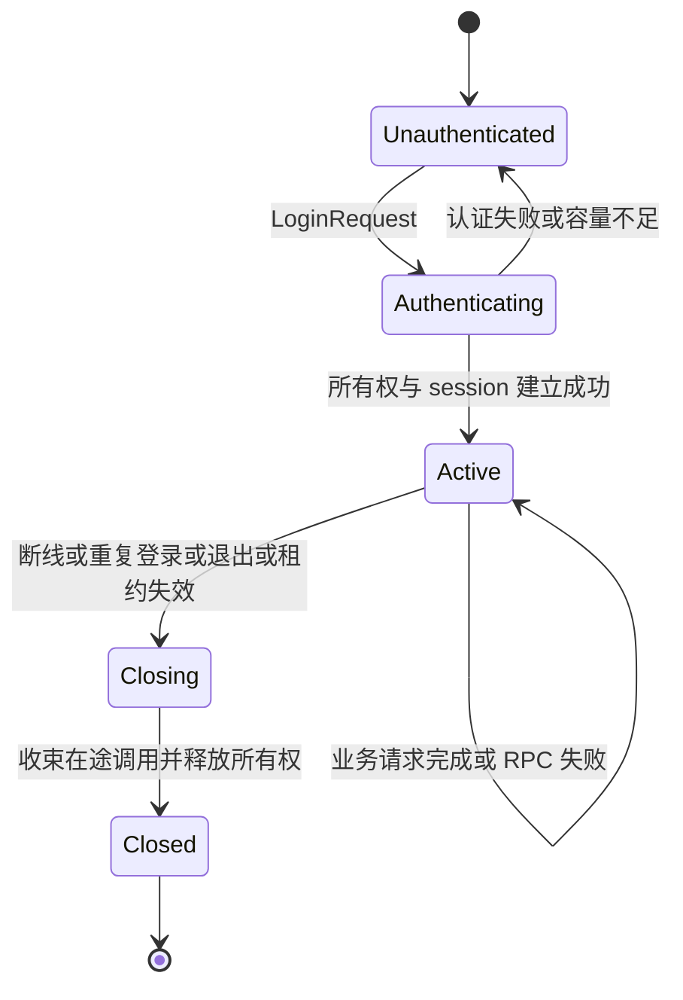

# 局外 TCP 协议与 session 实施约定

## 第二批目标与边界

本节至“验收与交付”记录第二批协议基线；当前第三批实现以文末“下行序列、确认与缓存”和 Rust 用户指南为准，客户端帧已升级为版本 2。已补充 Redis 开发发现、共享所有权、在线 timer 调度及 ACK 缓存，可独立配置 ownership=redis；跨网关活动租约仍拒绝抢占，恢复和交接未完成。断线仍立即停止 session。超时及存储尽力保护遵循设计文档的系统异常边界，不承诺绝对互斥。

第二批实现单进程开发链路：客户端通过 TCP 登录，认证扩展点返回可信 player id，网关取得内存所有权并建立串行 session，业务请求通过内部 RPC 调用 player，Response 返回客户端。示例提供状态读取、状态变更和 player 调用 guild，并用真实 TCP 客户端验收。

本批采用开发环境明文 TCP；认证逻辑由游戏注入，示例凭证只适用于本地开发。生产安全与内部调用认证按后续阶段实施。断线后立即关闭 session，停止新任务，收束已开始的 RPC 后条件释放所有权；第三批已实现在线 timer、server_seq、ack_seq 与有界缓存，断线宽限期、补发、resume_token 和跨网关交接仍待实现。

## TCP 分帧与消息

每帧由 4 字节大端无符号长度和 protobuf Frame 正文组成。长度只计算正文，必须大于零且不超过 max_frame_size；在分配正文缓冲区前检查长度。读取整个帧及写入整个帧都有期限，包含等待首字节的空闲时间；半帧 EOF、非法长度、解码失败和版本不匹配会终止连接。本批没有独立心跳帧。

Frame 使用版本 1，通过 oneof 区分 LoginRequest、LoginResponse、BusinessRequest、BusinessResponse、Notify 和 ControlError。客户端只发送登录和业务请求；不接受客户端伪造的回应、通知或控制错误。

| 消息 | 字段与用途 |
| --- | --- |
| LoginRequest | request_id、credential；凭证仅交认证扩展点，不记录日志 |
| LoginResponse | request_id、error_code、成功时的 player_id、session_id、epoch |
| BusinessRequest | request_id、message_id、body；玩家身份来自绑定 session |
| BusinessResponse | request_id、message_id、error_code、body；成功时使用注册的回应 ID，框架失败时使用原请求 ID，正文为空 |
| Notify | message_id、body；保留有界下行入口，尚无补发序号 |
| ControlError | request_id、error_code；表示无法按正常登录或业务回应处理的控制错误 |

每条连接的请求 ID 必须非零且严格递增，登录与业务请求共用这个约束。重复或倒退的 ID 返回 InvalidRequest，不重新执行业务；客户端不能依赖自动重试获取未知结果。message_id 必须非零，具体游戏 protobuf 及请求回应配对由游戏注册。

登录控制流程负责认证和会话建立；游戏初始状态通过登录后的业务请求读取。本批不将 SDK 鉴权或 timer 安装固化到通用 TCP 登录协议中。

## 连接与会话状态

Connection 是一个传输连接，session 是一个逻辑执行入口。未认证连接不能执行 player 业务；已绑定连接再次发送 LoginRequest 返回 InvalidState。重复登录使用新连接与认证凭证，不把旧 session 的身份直接交给客户端恢复。

同一 player 的重复登录按玩家范围协调：先取消旧连接与旧 session 的新任务入口，等待其已开始的调用结束或超时，再条件释放旧所有权并建立新 session_id 与 epoch。旧队列中尚未开始的任务失效，不转移给新 session；只有新连接能继续提交有效业务。不同玩家的登录和执行可以并发。

第二批只允许接管本进程维护的旧 session。发现另一个网关的所有权时返回 Unavailable，跨网关接管须等交接协议实现。所有权比较、续租和释放通过 OwnershipStore 契约，网关不直接依赖内存或 Redis 实现。

## 串行执行与资源控制

认证成功后，每个 player 使用独立的有界队列和一个执行任务。客户端请求进入此队列；后续 timer 和转发事件也使用同一执行入口。每次执行前检查会话活动状态并条件续租，不允许失效身份继续开启调用。

网关由 PlayerExecutor 契约调用 player；默认 RPC 适配器按可信 player id 选点并构造 CallContext。普通广播或主动 Notify 使用有界下行入口，不调用 player。RPC 调用和任意注入执行器均受调用期限控制，不自动重试；超时后远端 handler 可能仍在运行，沿用总体设计已接受的异常边界。

连接任务、session 任务和等待回应的任务必须受监督。退出时停止接收连接，取消活动 session，等待在途调用与条件释放；任务崩溃触发网关运行失败，交由 Application 清理。连接和 session 的容量、队列、帧长度及期限均有限。

| 参数 | 开发默认值 | 行为 |
| --- | --- | --- |
| max_connections | 128 | 连接容量满时关闭新连接 |
| max_sessions | 1024 | session 容量满时登录失败，关闭的记录可回收 |
| queue_capacity | 64 | 已在执行的任务之外最多等待的业务数，满时返回 QueueFull |
| outbound_capacity | 64 | 下行缓冲满时关闭慢连接 |
| max_frame_size | 1048576 字节 | 读写正文最大长度 |
| io_timeout_ms | 15000 | 单次完整帧读写期限 |
| auth_timeout_ms | 5000 | 认证扩展点执行期限 |
| rpc_timeout_ms | 5000 | player 业务调用期限 |
| ownership_ttl_ms | 30000 | 内存开发所有权的租期 |
| renew_interval_ms | 10000 | session 空闲时的续租间隔 |

配置验证要求所有值为正且具有合理上限；租期必须覆盖续租间隔与调用期限。本批默认值用于开发验收，不构成吞吐或生产容量承诺。

## 客户端错误与扩展点

框架定义成功、参数无效、未登录、认证失败、队列满、会话失效、服务不可用、调用超时、系统错误、状态无效、帧过大、未知消息、会话被替换和 session 容量不足等有限错误码。业务 RpcError 的非零错误码由游戏维护，普通业务成功回应仍由游戏的 protobuf 定义。

认证失败返回 LoginResponse；业务失败返回对应 request_id 的 BusinessResponse；无法关联或非法控制消息返回 ControlError 后按协议错误关闭连接。认证凭证、协议正文和 token 不进入框架日志。RPC Status 到客户端错误码通过可注入映射器转换；业务不可用与调用超时必须明确区分。

## 验收与交付

- 真实 TCP 客户端完成登录、状态读取、状态变更和公会查询；业务数据以 session 的可信 player id 为准。
- 同一玩家多个排队请求保持串行，不同玩家能够并发；队列满时快速返回 QueueFull，不能积压无界任务。
- 验证登录失败、未认证请求、未知消息、非法正文、重复 ID、错误版本、半帧、超限帧、慢连接与 RPC 超时；失败不能导致自动重试。
- 验证重复登录、新旧连接失效边界、旧任务拒绝、租约丢失、断线释放及网关退出，无脱管连接或 session 任务。
- 通过格式、clippy、missing_docs、测试、rustdoc、内部 RPC smoke 与新增客户端 smoke；同步更新实现状态和用户指南。

校准文档单独提交。第二批实现、测试和文档更新经用户审阅后独立提交。

## 第三批第二步：下行序列、确认与缓存

2026-10-19 校准并实施。以上章节保留第二批协议基线；本节记录当前版本 2 的实现约定。本步已实现在线 session 的统一下行序列、累计确认和有界内存缓存。断线仍关闭 session、停止 timer 并释放所有权；缓存随 session 关闭释放，不提供断线恢复入口。同网关恢复另一步实现，跨网关交接随后推进。

### 协议与序号范围

Frame.version 已升为 2，保留现有消息字段编号，在 BusinessResponse 和 Notify 增加 uint64 server_seq，并增加独立的 Ack 控制消息，内容为 uint64 ack_seq。客户端和 demo 同步升级；服务端只接受版本 2，明确拒绝版本 1，不同时维护两套会话语义。protobuf 包名与字段兼容性不代表客户端会话语义兼容。

| 消息或结果 | 是否进入下行序列与缓存 |
| --- | --- |
| 已绑定 session 的 BusinessResponse | 是，包含成功、业务错误及 QueueFull、InvalidRequest、RPC 超时等框架失败 |
| 已绑定 session 的 Notify | 是，与 BusinessResponse 共用序列 |
| LoginResponse、ControlError、Ack | 否，登录、协议错误与确认属于连接控制流程 |
| 内部 player RPC 结果、timer 执行结果 | 本身不进入；只有实际向游戏客户端发布的 Response 或 Notify 才进入 |

未绑定 session 的业务请求改用 ControlError 返回 Unauthenticated 或请求校验错误，不能产生 server_seq 为零的 BusinessResponse。登录失败仍使用 LoginResponse。已绑定 session 后的非法控制帧或非法 ACK 使用 ControlError 并关闭连接；此类错误不伪装成业务回应。

每个逻辑 session 从 server_seq=1 开始，逐条递增；0 表示尚无消息。达到 uint64 上限时停止该 session，不回绕。新登录和重复登录创建新 session，重新从 1 开始。未来恢复原 session 时才保留原序号。

request_id 继续关联请求与回应，并遵守现有每连接非零、严格递增的检查；message_id 继续标识业务消息类型。server_seq 按下行发布顺序分配，不按 request_id 排序：较晚请求的 QueueFull 回应可以先于较早请求的在途 RPC 回应发布。TCP 保证单条连接上的字节有序，逻辑 session 的序号用于确认和未来跨连接补发，两者职责不同。

### 统一发布与发送边界

所有面向游戏客户端的 Response 和 Notify，包括业务执行器结果、主动通知和连接读侧产生的业务拒绝，都通过同一个 session 下行入口。每个 session 在此入口串行完成尺寸检查、分配序号、编码、缓存提交及按序加入发送队列；不能在各个发送源或 socket writer 中分别分配序号。主动通知无需进入 player 业务执行队列，也不等待在途 RPC 完成。

帧大小按包含版本、序号等字段的最终 protobuf Frame 正文判断。超大 Response 在提交前转换为空正文的 FrameTooLarge 回应，保留 request_id，使用原请求 message_id；超大 Notify 在分配序号前拒绝。若最小错误回应仍无法容纳，则关闭 session。缓存提交后的字节不可再由 writer 修改；同一帧的缓存内容与写出的正文必须一致。

缓存保存完整 protobuf Frame 正文，不含 TCP 的 4 字节长度前缀，也不含连接专属加密封装。字节容量按实际编码长度计数。未来补发使用原编码字节和原序号，由新连接重新添加传输封装，不重新编码业务结果、不重新调用 player。

发布入口先提交缓存，再尝试向有界发送队列提交；序号分配、缓存与入队的临界区不等待网络 I/O。缓存一经提交即属于已发布下行，即使随后入队失败也不回收或复用序号。发送队列满或关闭时沿用当前关闭 session 的行为，本步不保留可恢复的离线 session。登录成功回应须先进入同一连接的发送队列，再开放该 session 的业务下行。

发布成功仅表示缓存与发送队列接收，不表示 socket 已写完；本地写入完成的 oneshot 通知也不表示客户端处理完成。客户端处理完成只能由 ACK 表达。

### 累计确认

客户端必须按 server_seq 连续应用业务状态，再报告已处理完成的最大序号 ack_seq。例如已处理 1、2、4 而缺少 3 时，只能确认 2；重复收到不大于已处理位置的消息时忽略其业务内容。本步只使用独立 Ack，不在 BusinessRequest 上同时增加确认字段；Ack 不消耗 request_id，不进入 player 队列，也不触发 RPC。

服务端将 Ack 关联到当前连接绑定的 session，不接受客户端指定其他 session。确认位置初始为 0；ack_seq 为 0、重复值或低于已确认位置时忽略，高于该 session 已发布的最大 server_seq 时属于 InvalidRequest。合法前进的 ACK 更新确认位置并释放不大于该位置的缓存。未认证连接发送 Ack 时返回 ControlError（Unauthenticated）并关闭连接。

ACK 上界使用已提交缓存的最大发布序号，不使用 socket 写入完成位置，避免读侧先收到合法 ACK、写侧尚未记录完成的竞争。ACK 是客户端对自身处理进度的声明，服务端只做范围检查，不证明客户端确实执行了业务状态更新。未来重绑定连接时，还必须拒绝已失效连接对原 session 的发布与确认。

### 缓存限制与可补发范围

每个 session 独立配置 replay_ttl_ms、replay_capacity 和 replay_max_bytes，分别限制消息原始发布时间后的保留时长、条数及编码字节总量。开发默认值为 30000 毫秒、256 条和 4194304 字节；上限分别为 86400000 毫秒、65536 条和 64 MiB，均须为正，replay_max_bytes 不得小于 max_frame_size。限制属于每个 session，实际占用随消息增长，不能把单会话字节上限当作整个网关的内存预算。

时间使用本地单调时钟。过期、条数超限或字节超限均从最旧记录开始淘汰，包含未确认消息；不能为等待 ACK 无限保留。重发不刷新原始发布时间。清理可以在发布、ACK 和读取缓存时进行，无需为每条消息创建定时任务；会话关闭时释放全部缓存。

维护已发布最大序号和已移除记录的最大序号，后者作为可补发下界，初始为 0。ACK 释放及容量、时间淘汰均更新该下界。未来请求从客户端确认位置 a 恢复时，只有 a 不小于下界、不大于已发布最大序号，且 (a, 最大序号] 的记录完整连续，才能补发；否则返回 ResumeUnavailable。客户端报告的位置比服务端已释放的确认位置更早，也不能通过静默跳号或重执行请求来修复。

例如已发布到 10，缓存仅保留 6..10：客户端确认 5 时可补发 6..10，确认 4 时无法补发，确认 10 时无需补发。在线期间淘汰未确认消息不立即关闭 session；若客户端之后确认到被淘汰范围之后，可补发范围随之推进，不将 session 永久标记为不可恢复。

本步只实现缓存范围查询及缺口判断，不增加 Resume 请求、resume_token 或对外 ResumeUnavailable 流程。缓存淘汰不改变已执行的业务，也不触发补偿、重试或回滚；request_id 与 ACK 均不提供请求幂等或恰好一次执行保证。

SessionHandle::replay_after 返回查询时的最大序号与连续编码正文快照，缺口或越界返回 None，关闭后返回 SessionClosed；查询不发送或确认消息。快照与缓存共享字节，调用方须及时释放，避免在缓存淘汰后继续持有内存。try_request 的独立结果只交给调用方，不自动发布、不消耗下行序号。

### 实施与验收顺序

1. 扩展版本 2 协议及中文文档，明确上行 Ack、下行业务序号与控制帧方向；更新 demo 客户端的按序处理及确认。
2. 实现 session 下行发布与缓存，将正常回应、拒绝回应和通知统一接入；writer 仅发送已经确定的帧字节。
3. 实现 ACK 校验、缓存释放及范围查询，继续保持断线立即关闭和现有 timer 行为。
4. 通过常规检查与真实 TCP smoke，同步更新 Rust 用户指南中的版本、错误处理和能力边界。

验收须覆盖 Response 与 Notify 交错、队列拒绝与 RPC 回应并发、序号连续递增且无重复、控制帧不占序号、未认证 ACK、确认零值及重复/倒退/越界、ACK 与写入完成竞争、超大帧转换后缓存与发送一致。使用可控时钟验证过期、条数和字节边界、确认释放、淘汰缺口及后续 ACK 推进；验证慢连接、关闭和重复登录能回收缓存，不增加业务执行次数。

第二步验收通过后再实现同网关恢复：分离连接与 session 生命周期，加入宽限期、token、重绑定、补发与新消息排序、恢复完成标记及快速重登。届时补充连接代次和恢复期间 ACK 的约束，不能仅靠已有缓存宣称支持重连。

本步 Windows 验收已通过：88 项常规测试、4 项文档测试、格式、clippy、rustdoc、三类本地 smoke、两项 Redis 多进程 smoke 和 release 构建；详细记录见实施大纲。代码与协议已按本节实现，恢复流程留待下一步。
