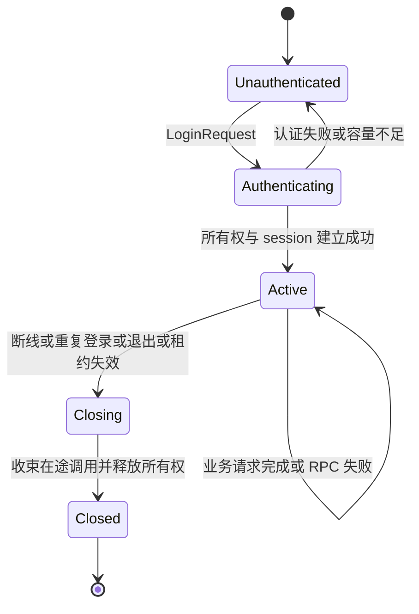

# 局外 TCP 协议与 session 实施约定

## 第二批目标与边界

本节记录第二批基线。后续已补充 Redis 开发发现与共享所有权，可独立配置 ownership=redis；跨网关活动租约仍拒绝抢占，timer、恢复和交接未完成。超时及存储尽力保护遵循设计文档的系统异常边界，不承诺绝对互斥。

第二批实现单进程开发链路：客户端通过 TCP 登录，认证扩展点返回可信 player id，网关取得内存所有权并建立串行 session，业务请求通过内部 RPC 调用 player，Response 返回客户端。示例提供状态读取、状态变更和 player 调用 guild，并用真实 TCP 客户端验收。

本批采用开发环境明文 TCP；认证逻辑由游戏注入，示例凭证只适用于本地开发。生产安全与内部调用认证按后续阶段实施。断线后立即关闭 session，停止新任务，收束已开始的 RPC 后条件释放所有权；断线宽限期、timer、server_seq、ack_seq、补发、resume_token 和跨网关交接属于第三批。

## TCP 分帧与消息

每帧由 4 字节大端无符号长度和 protobuf Frame 正文组成。长度只计算正文，必须大于零且不超过 max_frame_size；在分配正文缓冲区前检查长度。读取整个帧及写入整个帧都有期限，包含等待首字节的空闲时间；半帧 EOF、非法长度、解码失败和版本不匹配会终止连接。本批没有独立心跳帧。

Frame 使用版本 1，通过 oneof 区分 LoginRequest、LoginResponse、BusinessRequest、BusinessResponse、Notify 和 ControlError。客户端只发送登录和业务请求；不接受客户端伪造的回应、通知或控制错误。

| 消息 | 字段与用途 |
| --- | --- |
| LoginRequest | request_id、credential；凭证仅交认证扩展点，不记录日志 |
| LoginResponse | request_id、error_code、成功时的 player_id、session_id、epoch |
| BusinessRequest | request_id、message_id、body；玩家身份来自绑定 session |
| BusinessResponse | request_id、message_id、error_code、body；成功时使用注册的回应 ID，框架失败时使用原请求 ID，正文为空 |
| Notify | message_id、body；保留有界下行入口，尚无补发序号 |
| ControlError | request_id、error_code；表示无法按正常登录或业务回应处理的控制错误 |

每条连接的请求 ID 必须非零且严格递增，登录与业务请求共用这个约束。重复或倒退的 ID 返回 InvalidRequest，不重新执行业务；客户端不能依赖自动重试获取未知结果。message_id 必须非零，具体游戏 protobuf 及请求回应配对由游戏注册。

登录控制流程负责认证和会话建立；游戏初始状态通过登录后的业务请求读取。本批不将 SDK 鉴权或 timer 安装固化到通用 TCP 登录协议中。

## 连接与会话状态

Connection 是一个传输连接，session 是一个逻辑执行入口。未认证连接不能执行 player 业务；已绑定连接再次发送 LoginRequest 返回 InvalidState。重复登录使用新连接与认证凭证，不把旧 session 的身份直接交给客户端恢复。

同一 player 的重复登录按玩家范围协调：先取消旧连接与旧 session 的新任务入口，等待其已开始的调用结束或超时，再条件释放旧所有权并建立新 session_id 与 epoch。旧队列中尚未开始的任务失效，不转移给新 session；只有新连接能继续提交有效业务。不同玩家的登录和执行可以并发。

第二批只允许接管本进程维护的旧 session。发现另一个网关的所有权时返回 Unavailable，跨网关接管须等交接协议实现。所有权比较、续租和释放通过 OwnershipStore 契约，网关不直接依赖内存或 Redis 实现。

## 串行执行与资源控制

认证成功后，每个 player 使用独立的有界队列和一个执行任务。客户端请求进入此队列；后续 timer 和转发事件也使用同一执行入口。每次执行前检查会话活动状态并条件续租，不允许失效身份继续开启调用。

网关由 PlayerExecutor 契约调用 player；默认 RPC 适配器按可信 player id 选点并构造 CallContext。普通广播或主动 Notify 使用有界下行入口，不调用 player。RPC 调用和任意注入执行器均受调用期限控制，不自动重试；超时后远端 handler 可能仍在运行，沿用总体设计已接受的异常边界。

连接任务、session 任务和等待回应的任务必须受监督。退出时停止接收连接，取消活动 session，等待在途调用与条件释放；任务崩溃触发网关运行失败，交由 Application 清理。连接和 session 的容量、队列、帧长度及期限均有限。

| 参数 | 开发默认值 | 行为 |
| --- | --- | --- |
| max_connections | 128 | 连接容量满时关闭新连接 |
| max_sessions | 1024 | session 容量满时登录失败，关闭的记录可回收 |
| queue_capacity | 64 | 已在执行的任务之外最多等待的业务数，满时返回 QueueFull |
| outbound_capacity | 64 | 下行缓冲满时关闭慢连接 |
| max_frame_size | 1048576 字节 | 读写正文最大长度 |
| io_timeout_ms | 15000 | 单次完整帧读写期限 |
| auth_timeout_ms | 5000 | 认证扩展点执行期限 |
| rpc_timeout_ms | 5000 | player 业务调用期限 |
| ownership_ttl_ms | 30000 | 内存开发所有权的租期 |
| renew_interval_ms | 10000 | session 空闲时的续租间隔 |

配置验证要求所有值为正且具有合理上限；租期必须覆盖续租间隔与调用期限。本批默认值用于开发验收，不构成吞吐或生产容量承诺。

## 客户端错误与扩展点

框架定义成功、参数无效、未登录、认证失败、队列满、会话失效、服务不可用、调用超时、系统错误、状态无效、帧过大、未知消息、会话被替换和 session 容量不足等有限错误码。业务 RpcError 的非零错误码由游戏维护，普通业务成功回应仍由游戏的 protobuf 定义。

认证失败返回 LoginResponse；业务失败返回对应 request_id 的 BusinessResponse；无法关联或非法控制消息返回 ControlError 后按协议错误关闭连接。认证凭证、协议正文和 token 不进入框架日志。RPC Status 到客户端错误码通过可注入映射器转换；业务不可用与调用超时必须明确区分。

## 验收与交付

- 真实 TCP 客户端完成登录、状态读取、状态变更和公会查询；业务数据以 session 的可信 player id 为准。
- 同一玩家多个排队请求保持串行，不同玩家能够并发；队列满时快速返回 QueueFull，不能积压无界任务。
- 验证登录失败、未认证请求、未知消息、非法正文、重复 ID、错误版本、半帧、超限帧、慢连接与 RPC 超时；失败不能导致自动重试。
- 验证重复登录、新旧连接失效边界、旧任务拒绝、租约丢失、断线释放及网关退出，无脱管连接或 session 任务。
- 通过格式、clippy、missing_docs、测试、rustdoc、内部 RPC smoke 与新增客户端 smoke；同步更新实现状态和用户指南。

校准文档单独提交。第二批实现、测试和文档更新经用户审阅后独立提交。
