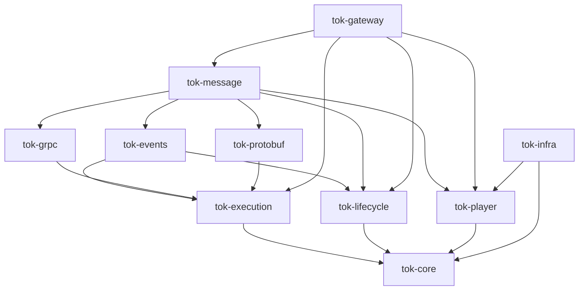

# tok 总体设计

tok 是 Rust 游戏服务器框架，核心职责是构建“服务 + 处理链”的概念与基础设施。tok-gateway 是基于共同设施提供连接与会话语义的内置扩展。游戏通过一个二进制、不同配置组合服务，目标平台为 Windows amd64 与 Linux amd64。

本文规定已确认的架构与系统边界，不以目标 API 代替当前实现。[实现状态](status.md)记录现状，[服务运行模型](service-runtime.md)细化目标契约，[实施计划](implementation-plan.md)规定校正顺序，[文档导航](README.md)说明各文档职责。

## 服务与处理链

```text
服务 = 状态 + 入口路由 + 处理链
处理链 = 中间件 + 业务 handler
运行设施 = 初始化 + 就绪 + 任务监督 + 停止与清理
```

RPC、客户端业务消息、本地/NATS 事件及 timer 是触发服务执行的入口，使用共同执行上下文与中间件协议。入口适配负责解码、可信身份建立和协议映射；调度负责直接执行、session FIFO 或用户选择的实体互斥；处理链执行业务；结果适配负责对应回应或事件执行结果。

服务可以只安装 RPC 或事件入口，也可以同时安装。服务级与路由级 Layer 共用协议，用户决定链、顺序和适用范围；统一抽象不要求各入口使用同一个中间件实例。业务事件也经过处理链，不另立独立事件中间件体系。

RPC 返回回应，事件返回当前处理阶段的结果，不自动生成客户端 Response；发布成功不表示接收侧 handler 完成。本地 dispatch 在当前任务等待处理完成，远程 publish 只等待传输接受。协议类型、完成边界和错误映射不能为统一而混淆。

## 框架核心与扩展分层

“tok 核心”指通用架构职责，不意味着所有基础设施放入名为 tok 的门面 crate。tok 已依赖 tok-gateway，gateway 不能再反向依赖 tok 获得共同设施。

| 层次 | 职责 | 边界 |
| --- | --- | --- |
| tok-core 基础契约 | 服务身份、Extensions、发现、路由及请求锁契约 | 不依赖玩家运行契约、gateway、具体 RPC 协议或 NATS |
| tok-player 玩家运行契约 | 会话身份、逻辑消息、计时需求、所有权与恢复凭证 | 只依赖 tok-core，不实现网络、调度或存储后端 |
| 调用执行设施 | 执行上下文、类型化请求、Tower 处理链与预算/取消约束 | tok-execution，不管理服务构建与后台任务 |
| 按键分发模块 | 根据泛型键选择输入、结果和错误均可自定义的处理链 | tok-execution::registry，不规定编码或协议；protobuf 适配归 tok-protobuf |
| 服务生命周期设施 | 服务工厂、启动阶段、退出与有界任务监督 | tok-lifecycle，不依赖执行层或 Tower |
| 通信与事件适配 | 协议、编解码、发布订阅与结果映射 | 复用共同执行核心，不各建中间件引擎 |
| tok-gateway | 连接、认证、session、FIFO、timer、下行恢复与交接 | 通用服务的内置扩展，不是普通服务的必选基类 |
| tok 门面及应用组装 | 统一导出、节点配置、端点和整应用组装 | 可以依赖上述组件，供游戏便捷使用 |

关键依赖方向如下；箭头表示依赖，不枚举协议生成与第三方库：



依赖方向为“门面/游戏组装 → 扩展与适配 → 共同设施 → 基础契约”。实际依赖允许按用途引用更下层组件，禁止形成循环或反向依赖具体游戏。P1 最初将上下文放在 tok-core；当前 Context / StopReason 已归 tok-execution，与类型化执行和 Layer 放在一起，Extensions 独立为 core 的基础容器；P2 已将公共工厂与生命周期沿这一落点下沉，P3 已将 RPC/事件及 RPC timer 路由接入共同处理链；P4 已接入 gateway/session 能力、状态工厂与业务消息 Layer。共同设施不能长期留在门面，再由 gateway 复制实现；也不为分层图预先增加空 crate。

Gateway 复用构建、上下文、Layer、任务监督和退出设施；监听、session 调度、恢复与交接保留各自状态机，不强制合并成一个循环。通用设施不能到处判断 player/scene。tok-execution、tok-lifecycle 与 tok-events 不依赖 tok-player；tok-grpc 不依赖玩家、事件或游戏 protobuf；tok-message 和 gateway 按需消费玩家契约，tok-infra 提供相应后端。游戏协议 CallContext 归 tok-message::rpc，不能因跨模块共享再放回 core。游戏自定义服务与内置 gateway 使用相同扩展契约。

Application / Gateway 已复用同一 Factory 与生命周期，RPC、事件及网关业务入口使用共同 Request / Tower 协议。协议适配仍保留游戏协议 Handler、Executor 等不同输入与结果，不另建平行的执行或事件中间件系统；具体能力与未实现范围以实现状态为准。

## 公开 API 与内部模块

公开 API 按使用者概念组织，内部模块按实现需要组织，通过 pub use 解耦；规则与依据维护在 [AGENTS.md](../AGENTS.md#rust-公开-api-与模块组织)。实现文件默认不构成公开路径；需要理解、组合或扩展的功能提供公开模块，主要入口可根重导出。公开模块与根重导出可以并存，不因双路径或角色名前缀做机械重构。

core 的 discovery / lock / routing / service 是功能命名空间，常用身份、发现与路由契约同时根导出。extensions 是内部文件，Extensions 与 BoxFuture 从根访问；各领域 Error / Result 位于其功能模块，不提供根错误。玩家 TimerTrigger 从 tok-player 根访问。公开 API 不要求复刻文件树，也不要求所有模块同一种可见性。

## 身份、路由与作用域

| 标识 | 职责 |
| --- | --- |
| node_id + service_name | 定位节点内服务，服务名在该节点唯一 |
| bid | 业务实体身份，如 player_id、guild_id；用于亲和路由与可选互斥 |
| session_id + epoch | 可恢复逻辑会话及所有权代次 |
| message_id | 客户端业务消息类型与显式请求/回应配对 |
| request_id | 请求关联及准入顺序，不是补发正文或业务幂等键 |
| event_id | 同一次事件的稳定身份，重复发布/转发保留 |
| server_seq / ack_seq | 下行发布顺序与客户端累计处理进度 |
| topic / group | 业务路由主题与实例消费分担方式，不是玩家身份或所有权 |

一个服务可处理多个 bid，框架不自动为每个实体创建对象、任务或资源隔离。实体状态与读缓存由业务组织，需要 bid 亲和时由路由组件在可用服务快照中选点。发现提供地址，路由决定选点，所有权决定谁可驱动会话，三者独立。

节点启动工厂默认按 service_name 查找，可用可选 factory 选择不同工厂；同一工厂可创建多个身份的服务。服务通过 endpoint 引用节点端点，共享端点由组装层绑定一次。protobuf 服务名与业务服务名的映射必须显式定义。

## 执行上下文、中间件与状态

Context 的固定部分包含服务/操作身份、追踪、截止点与取消。Request<T> 在 Context 和输入之外持有输入 Extensions；成功输出 Response<R> 持有结果与独立的输出 Extensions，不含 Context。入口关联信息及目标实体由各层的类型化输入或扩展表达；可信入口校验不依赖正文自报的身份。消息正文、业务状态与调用元数据分别表达，不能用一个堆满可选字段的大结构代替类型契约。

运行能力通过类型化扩展提供：普通服务取得自己的状态与生命周期；gateway 增加网关和 manager 句柄；会话执行再增加对应 session。查询返回只读快照，停止请求与结束等待区分，操作本身重新校验状态。跨进程仅传播允许的元数据，不序列化内存句柄或取消令牌。

用户用 Tower Layer / Service 思路组合业务鉴权、预算、限流、日志和自定义处理。强制身份/协议校验、player 所有权、队列容量及 FIFO 不可通过移除用户 Layer 绕过。准入、执行、新下行是不同安装位置；补发缓存字节不再次执行新下行处理链。

本地事件可借用当前 &mut 状态，在当前任务执行并继承调用预算；不隐式 spawn、排队、序列化或重新进入自身 session 门锁。同步处理函数适配到共同契约。具体借用、泛型与 Tower 组合由首批编译样例验证，不能以实现困难为由退回两套业务注册接口。

业务状态有明确的服务/会话作用域，由工厂创建；关闭、恢复和交接的行为由扩展契约声明。必需的跨网关状态必须提供有界快照和恢复适配，不能静默丢弃，也不承诺任意游戏内存自动迁移。

## 事件与订阅

事件完全由服务器驱动。客户端没有 Event 帧、通用事件发布代理或传输订阅管理入口；游戏可在普通请求验证权限后主动发布或修改主题成员。请求、内部事件、timer 的分发表和结果约束保持隔离，共同使用执行协议不等于相互冒充来源。

Event 定义稳定事件契约；Envelope<E> 表达强类型事件；Message 表达编码后的通用表示；EventEnvelope 定义网络封装。目标是本地和远程使用同一封装、处理表和上下文，远程 codec 属于适配，本地 Rust 事件无需为未使用的远程路径实现 protobuf。

topic 是业务发布订阅路由，Event::topic 默认全局，可由事件契约固定或根据正文派生；事件类型定义正文和 handler，group 则属于订阅组件，决定匹配实例间如何分担。本地 Target 决定收到事件后实际投递哪些会话，不与传输路由强行合并。P5 的 NATS subject 已包含 namespace、安全编码的 topic 和事件类型，业务不直接拼接 subject。

P6 已提供固定兴趣、会话动态兴趣和可信身份策略（如区服主题）。网关按组件、topic、事件类型和 group 合并兴趣，多个玩家共享订阅；首个需求建立，最后一个动态需求退出时释放，固定兴趣单独计数。加入等待就绪、失败回滚、退出重验、旧会话清理和交接的完整边界见[服务运行模型](service-runtime.md#订阅组件与动态兴趣)。

无 group 时各匹配实例独立接收，同名 group 内分担，不同组独立接收。聊天主题跨多个网关时，直接本地广播的组件必须让各目标网关收到事件；共享 group 本身不提供扇出或玩家归属路由，框架不固定 gateway 的 group。

发布成功只表示传输接受，不代表 broker 接收、handler 完成、player 执行或客户端处理。仅订阅建立做有界就绪确认。Core NATS 允许即时消息在离线、过载及冻结窗口丢失，不自动重试/去重。持久化、重新投递与消费确认留给后续 JetStream 设计；届时不得把进入 session 内存队列当成业务完成。

## gateway 与 player 边界

玩家接入是 gateway 的具体组件：取得可信身份和所有权、维护逻辑 session、串行驱动 player。Scene 是未来的接入扩展，不要求复制网关运行模型，也不强制复用 Player 的所有权与执行语义。

player 无状态指执行能力不依赖常驻 player 实例或客户端连接，不代表业务数据不存在或不能使用读缓存。所有客户端请求、timer 和转发事件都经有效 session FIFO 驱动，其他服务不能绕过该入口直接修改 player。转发事件按正文选玩家，通知直接进入客户端下行，不执行 player。

普通登录、顶号、短线恢复和快速重登语义分别保留。有效 session 由所有权租约协调；顶号更新会话标记，旧 token 即使签名未过期也不能恢复新会话。新登录全量业务初始化由游戏显式完成，不增加固定 player 登录 RPC。

现行 Frame v3、计时、下行序列、ACK、宽限期、HMAC 凭证刷新、同网关恢复与跨网关交接见[客户端与会话协议](client-session.md)。本轮迁移以该协议为不变量，确需破坏性调整时单独记录，不因重构重置序号或重复业务。

## 全局实例的请求级锁

公会等实体可选择按服务命名空间与 bid 加锁：获取有期限的锁，执行 handler，条件释放。该策略由用户安装，不从服务名推导，不默认套到 player 或 GatewayRpc 交接入口，也不等于为每个实体创建常驻对象。

当前 Memory/Redis 后端与 RPC 锁 Layer 已实现。方向校正中保留锁后端契约，将执行适配接入共同 Layer 协议。业务锁、session 所有权与订阅 group 的职责独立。

## 系统异常边界

RPC 不自动重试，超时不代表远端业务停止或回滚。本地 session 可按正常流程继续，但异常情况下远端仍可能执行，框架不承诺超时后严格隔离、结果追踪或恰好一次。

Redis 获取/续租及业务发起前按操作开始时刻和单调时钟保守检查有效预算；已失效或不确定时停止新调用。检查后仍可能发生暂停或租约过期，系统接受该竞态窗口，不默认逐次远程写校验、强制 fencing 或分布式事务。后续存储封装可按调用与租约期限做尽力保护，当前不宣称已实现。

业务幂等以业务操作 ID、版本、条件更新或事务承担。event_id 和有界内存去重不能替代跨进程资产幂等。重连补发只重发已编码下行，不重执 RPC、事件、timer 或中间件。

关闭与交接均有资源上限和期限，取消不回滚已发生副作用。正常退出协作清理，强制丢弃 future/进程退出不承诺异步回调必达。内部字段校验不代替调用者认证，当前开发链路不等于已提供生产安全。

## 发现、配置与部署

Memory 服务发现用于单进程，Redis 用于多进程开发，Kubernetes Service / EndpointSlice 监听与本地缓存是生产目标；不额外引入 etcd。业务路由只读本地目录，不在每次请求中同步访问发现后端。Redis 发现不代替 session 所有权。

node_id 在部署范围内唯一，活动实例及重启代次单独检查；旧进程不得修改新实例注册。端点 address 是监听地址，advertise_address 是发布地址；通配监听地址不能直接对外发布。服务完成初始化和依赖就绪后发布，退出撤销，失败按监督规则收束。

同一个游戏二进制在每个平台分别构建，按 TOML 启用不同服务。共享监听与业务服务分开管理；同一 protobuf 服务不能在一个端点重复绑定。HTTP/WebSocket/KCP 等是可扩展适配目标，不代表已经实现。现有开发接入为明文 TCP，TLS/DTLS 或消息安全方案后续单独选型，恢复不迁移旧连接的流量密钥。

Kubernetes 配置可校验但后端未实现，部署目录尚无可运行清单。生产发现、安全、Redis Cluster、Scene 和存储等在本轮核心校正后继续推进。

## 工程与可观测

现有 workspace 包括 tok-core、tok-execution、tok-lifecycle、tok-player、tok-proto、tok-grpc、tok-message、tok-events、tok-gateway、tok-infra、tok-observability 和 tok。游戏协议属于 demo/game；框架协议属于 tok-proto。protobuf 构建期生成到 Cargo OUT_DIR，不提交生成的 Rust 文件。

游戏消息 ID 可由 proto 枚举在构建期按名字生成关联，运行时仍按数字分发，配对与权限显式注册。未发布 API/协议直接校正，不增加开发中间状态兼容别名；正式发布后的破坏性变更再按版本策略处理。

使用 Rust 原生 rustdoc 作为用户/API 文档，公开项以 missing_docs 检查；工具链、依赖、lint、LF、just 与 CI 在 workspace 统一。库不反向依赖具体游戏，API 名称和模块遵循 Rust 风格并保留清晰的使用端语义。

日志、指标与追踪由进程入口初始化一次，服务和 Layer 复用。日志默认不记录凭证和正文，指标标签不使用 player_id、bid 或 request_id；W3C 追踪随 RPC metadata 和 NATS headers 传播。有限预算与取消不因中间件或本地派生调用重置，已开始的追踪决定不被运行时配置回写。

## 后续范围

本轮已沿七批计划完成统一执行、构建、生命周期、gateway 扩展和动态 topic，并收敛配置组装；验收结果与平台边界分别记录。JetStream、离线加载、通用跨节点去重、生产安全、Kubernetes、Redis Cluster、Scene、配置式中间件及无缝场景切换另行实施。

Redis Cluster 缓存与 MongoDB 集群是存储选型方向，存储 API 由业务定义、实现独立；缓存失效、持久化时机、事务和版本检查尚未设计，不纳入本轮。跨实体一致性由业务处理，框架不扩展通用补偿事务。

## 通用 RPC 与游戏协议适配

tok-grpc 只提供 Client、Listener 和 Server；Server 接受任意类型化 Tower Service，客户端 execute 接入任意生成协议。它不依赖 tok-player、tok-events 或 tok-proto，不定义玩家事件方法。tok-message 基于这些设施提供游戏消息注册、CallContext、玩家身份校验、timer、事件转发及可选业务请求锁；通用任务、生命周期和处理链仍分别由 tok-lifecycle / tok-execution 提供。

游戏协议可以有 Call 与 HandleEvent 等不同远程方法；方法数量不是分层依据。session 通过玩家客户端适配调用 HandleEvent，由玩家服务适配解码并进入事件 Registry 和同一 Tower 处理模型。事件由服务器驱动，客户端业务入口不能选择事件或 timer。独立游戏协议层的 Handler 是游戏分发契约，不是通用 RPC 必须实现的接口。tok 门面的 grpc / message::rpc 分别对应这两层，不保留旧游戏 API 路径。

## 调用执行与生命周期分库（2026-10-21）

原 tok-service 拆为 tok-execution 与 tok-lifecycle。tok-execution 保留 Context / StopReason、Request、Tower Layer / Service、Call 和 SyncHandler；tok-lifecycle 根导出 Factory / Init / InitFuture、Builder / Prepared / Running、Handle / Phase / Error，task 模块保留 Supervisor / Handle / Reservation / Task 等通用监督能力。两库共同依赖 tok-core，彼此无依赖；tok-lifecycle 不依赖 Tower、RPC、事件或玩家协议。门面路径改为 tok::execution / tok::lifecycle，不提供旧 tok-service 或 tok::service 兼容路径。

应用、RPC、事件、网关、示例及指南使用新路径；服务启动就绪、任务容量、预算取消、退出等待及线协议语义不变。本轮不做 release 构建。

## 执行上下文移除固定来源（2026-10-21）

Context 移除 source 字段、Source 枚举和构造/child 的来源参数。执行 Context 只管理服务、操作、期限、取消与追踪；类型化扩展位于 Request / Response。RPC、事件与网关在入口提供类型化扩展：复用游戏 CallContext、EventId / Topic / Arc<Message>、TimerTrigger，仅网关新增无正文的 ClientRequest 关联标识。RPC 关联信息与事件元信息可以共存，不再将传输方式、触发原因和客户端入口混成互斥枚举。

事件 Registry 的本地与远端分发提供相同事件头，派生子上下文覆盖当前事件头，不修改父扩展；本地派生仍清除继承的原始编码。客户端无法发布事件、请求与 timer 分表、会话身份校验、预算和取消约束保持不变；Extensions 元信息不作为认证证明。调用方和指南已迁移，不保留 Source 兼容类型。

RPC 客户端连接策略可通过 Client::with_endpoint_factory 扩展，服务端传输通过 Listener::from_server 复用 Tonic Server 配置。连接共享边界仍为节点与地址，同一边界采用一致传输策略；TLS 证书与域名验证由应用配置 Tonic，不放入通用服务发现契约。默认构造维持本地开发使用的明文传输。

## 消息分发与游戏协议边界

tok-execution::registry::Registry<K, T, R, E> 根据泛型键选择并执行处理链，不固定 u32 消息 ID、字节正文、回应结构或编码格式。K 只需 Ord + Clone，不要求 Display；键的业务有效性归调用方。tok-execution 不依赖 prost、Tonic 或生成协议。

protobuf 正文编解码位于 tok-protobuf，基于同一个通用分发表实现。它的消息键仍是泛型；具体游戏线协议选择 u32 并在边界施加非零约束。普通业务 RPC 适配负责 CallContext 与业务状态转换、构造协议回应及错误到 Status 的映射，本地与 RPC 可共用同一业务注册器。

玩家请求、timer 与服务器事件组合的后续校正仍单独推进。事件继续使用 tok-events，统一的是 Request / Tower 协议，不强行合并所有分发表；通用请求锁的取键泛化已完成，通知归属迁移仍待推进。不提供独立的 tok-dispatch crate 或门面别名。

## 按功能域拆分基础错误（2026-10-21）

服务发现、请求锁和路由契约分别使用 core::discovery::{Error, Result}、core::lock::{Error, Result}、core::routing::{Error, Result}；不提供旧领域变体兼容别名。路由的 Discovery 包装保留原发现错误与错误链，Application::Error 增加 Discovery 聚合，注册、清理和故障传播均使用该类别。后端错误按相应领域映射，不返回其他领域的变体。

core 不提供根 Error / Result，参数、配置和可选能力校验由实际所属组件表达。所有权后端故障使用 player::ownership::Error::Unavailable，冲突、配置、凭证与不可用语义保持区分。Redis 发现与锁构造/校验采用所属领域错误，整体应用配置在边界映射为 config::Error::Invalid。

registry 注册错误定名为 Error<K>，运行失败定名为 DispatchError<K, E>；后者覆盖未知键与业务处理错误，执行停止统一由 execution::Error::Stopped 表达，避免 HandleError 误指只有处理者内部失败。protobuf 适配与示例同步新路径，不保留 RegistrationError 旧类型。

## 移除 core 根校验错误（2026-10-21）

删除 tok-core/error.rs 及根 Error / Result，领域发现、锁和路由契约不变，不提供兼容类型。剩余校验能力回到所属模块：execution::ContextError 表达无效服务身份、操作名和不可表示期限；lifecycle::task::CreateError 表达无效容量和父范围退出，lifecycle::CreateError 表达服务身份及底层任务范围构造失败。构造失败与运行错误分开，组合处保留原始来源。

应用配置使用 tok::config::{Error, Result}，Application 以 Configuration / Create / Discovery 聚合配置、构造和发现错误，Unsupported 表达应用尚未实现的可选能力。所有权和凭证错误分别归 player::ownership::Error 与 player::credentials::Error，不再经 Core 包装；玩家接入运行参数单独使用 gateway::player::ConfigError。示例业务状态构造采用自己的标准 I/O 参数错误，不依赖框架根错误。

## protobuf、编号消息与 gRPC 边界（2026-10-21）

tok-proto 仅提供生成协议；tok-protobuf 在 tok-execution 上适配泛型键的正文编解码，不依赖生成游戏协议、玩家或 Tonic。tok-message::Registry 在其上施加 u32 非零编号规则，保留调用状态、附加结果和业务错误，支持直接本地调用。

tok-message::rpc 承载 CallContext、玩家与普通业务客户端、Service、绑定槽，以及 timer/事件的线协议转换和 Status 映射。HandlerRegistry 是该命名空间下组合玩家调用、timer 和事件的协议适配器，其普通消息表复用根 Registry；它不是通用执行或 protobuf 的必选入口。tok-grpc（原 tok-rpc）明确限于 Tonic/gRPC 的连接、监听、调用预算、取消和追踪，不理解编号消息或玩家协议。门面对应 protobuf / message / grpc，不提供旧路径别名。

## 玩家契约的领域边界（2026-10-21）

tok-player 的会话、逻辑消息和计时类型继续根导出；ownership 与 credentials 是独立功能命名空间，各自定义 Error / Result，不提供玩家根错误。所有权持有者复用 tok-core::Identity，Record 只组合会话身份和持有者，不重复定义部署服务身份。

所有权错误区分比较冲突、容量不足、后端不可用、输入、配置与不支持的操作；凭证错误只描述签发参数、配置与本地组件故障，非法或过期凭证返回 None。诊断不能包含连接凭据、密钥或 token。网关将所有权容量不足映射为已有 CapacityExceeded 客户端错误码，不改变线协议编号。

## 通用请求锁中间件（2026-10-21）

tok-core::lock 定义后端与租约契约，tok-infra::locks 提供 Memory / Redis 实现，tok-execution::lock 提供与业务输入、回应和传输无关的 Tower Layer。取键函数接收 Request 的借用，返回完整 Key 或原始业务错误；结果判断函数说明 Ok 回应是否表示业务成功。业务结果与错误保持原类型，释放失败只覆盖业务成功。

tok-message::rpc::lock 是薄协议适配，校验固定逻辑服务与 CallContext.bid，提供回应判定并将通用错误映射为 Status；不再实现获取、持锁、超时和释放循环。通用 Config 不含 RPC 命名空间，只提供时间预算。当前适配要求自有 Send + static 输入、回应和业务错误，不创建后台任务；现有借用执行能力不受影响。不新增 tok-middleware 或 tok-common。

## 框架处理链的 Context 契约（2026-10-21）

框架业务执行与用户扩展入口以 tok-execution::Request<T> / Context 为共同契约，适配器对第三方协议二次封装。同一执行范围中的输入转换、排队、任务切换与中间件组合保留上下文；派生执行不重置截止点。执行所属服务与出站目标分开表达，Context / Extensions 不充当线协议。

独立事件消费、timer、生命周期与补偿工作可以建立新范围，但必须声明范围边界、预算、停止关系和扩展规则。跨服务或 session 时由目标安装本地能力；跨进程仅传播白名单元数据并重建 Context。基础容器、存储后端和普通辅助函数不受统一请求签名限制，原生传输入口之外须有符合框架契约的执行适配。

完整规则见[执行上下文连续性规范](service-runtime.md#执行上下文连续性规范)，代码差异见[审查记录](status.md#执行上下文连续性审查2026-10-21)。当前 gRPC 出站、游戏协议适配、网关准入/队列/投递与内部交接已接续 Context；独立消费与补偿的范围规则见运行模型。

## gRPC 处理链扩展（2026-10-21）

gRPC 的连接缓存、监听、metadata 转换保留为边界组件；执行范围通过 client::{Layer, Service} 和 server::{Layer, Service} 表达。主要配置入口 Client / Server 保持根导出，功能命名空间公开，内部执行 Future 的实现模块私有。Client::execute、execute_service 与 Server::execute 是同一执行链的便捷方法，内置协议适配器不会自动获得用户出站策略。

客户端 Layer 将 Request<client::Call<T>> 转换为 Request<PreparedCall<T>>，保留 Context，允许外层策略在连接获取前选择目标或拒绝调用；本地预算沿用原截止点，Client 与 metadata 限制只能收紧；已发生的外层等待扣减剩余时间，外层等待期间的及时停止由外层保护负责。PreparedCall 提供已选定目标与类型化 tonic::Request，Context.service 保持本地身份，发送器通过 into_parts(&context) 校验当前停止条件并缩短远端期限，不重复保存一份执行期限。可重复调用的 Service 克隆内层，需要跨请求共享的策略状态由策略显式共享。便捷客户端方法同样接收执行 Request，可消费非 Clone Service / FnOnce 回调，支持借用输入和 Future，不另设执行循环，不主动重试。

服务端 Layer 接收 execution::Request<T>，校验服务身份、复用 execution 执行约束并映射停止原因与指标。Server::context 继续负责 metadata 转换，Layer 不新建期限或进行认证。Client 克隆共享配置与 Channel 缓存，更换工厂为该实例建立独立配置。Listener::from_server 接收带 Layer 的 Tonic Server，Listener 与 Application 注册保持非泛型，服务绑定和就绪规则不变。


## 分发表作为路由 Service（2026-10-21）

分发表选择多个已注册处理链中的一条，作为 Tower 路由 Service 参与组合，不包装成只增强单个内层 Service 的 Layer。公共策略位于分发表外，路由专用策略位于注册链内；执行范围可保护整条公共策略和路由链，Context 与错误保持各层既有职责。

通用 execution::Registry 由 into_service 显式接收 Request 取键函数；protobuf / message 注册器的正文已含键，可直接实现 Service。路由入口的 poll_ready 不代表某个目标已预留容量，选中路由后的就绪等待在原范围中执行。不为此引入后台队列、自动重试、默认 fallback 或热更新协议。

## 输入与输出封装校正（2026-10-21）

Request 与 Response 分别由 tok-execution 私有 request.rs / response.rs 实现并根导出。输入转换、编解码、路由、客户端与网关队列保留请求扩展；输出转换保留回应扩展。Context::child 只处理执行范围，调用方显式接续适用输入能力；封装类型不返回 ContextError。事件聚合、通知投递和传输终点的规则见运行模型，Rust 指南提供可执行示例。此变更不修改线协议、所有权、会话串行、独立事件或无重试约定。

## 注册器接口与扩展写时复制（2026-10-21）

通用 execution::Registry 定义注册与派发契约，Key / Input / Output / HandlerError / DispatchError / RegistrationError 为关联类型；register_handler 接收已擦除的受保护 Handler，dispatch 允许自定义查找、拦截、委托和动态状态策略。默认 Table 使用静态 BTreeMap，重复键拒绝；排序与 Clone 约束属于 Table，不作为所有实现的限制。Registry 支持 trait 对象，泛型注册便捷方法仅用于自有实现；Tower 路由 Service 保护取键与整个自定义派发过程。

protobuf、message 及游戏 RPC 适配器通过泛型和 from_registry / from_shared_registry 注入实现，继续负责各自编解码、非零编号和协议校验；不复制通用分发表，也不将自定义实现改写成另一套执行协议。默认实现保持注册快照，自定义克隆是否共享更新由实现声明。注册错误保留具体类型；不预置动态管理、分布式选点或重试规则。事件借用分发与 fan-out 仍由 events::Registry 管理，不机械合并单目标消息表。

Extensions 克隆以 O(1) 共享整张表，空集合不分配表。修改共享非空表时复制键与值的 Arc，业务对象仍共享；容器修改不回写其他克隆。移除不存在的类型、合并空集合不复制表，向空集合合并直接共享已有表。该调整不改变 Request / Response 的扩展方向、会话能力作用域或跨网络传播规则。


### 执行错误契约校正（2026-10-21）

execution::Error<E> 与 Request / Response 一起从根公开，统一表达 Stopped 与 Inner(E)；E 保留具体处理错误。
Registry 关联类型使用 HandlerError、DispatchError 与 RegistrationError；dispatch 和路由 Service 均返回
execution::Error<G::DispatchError>。默认 Table 的 DispatchError 仅包含 Unknown / Handler，不重复存放执行停止。
protobuf / message 适配保持这一层结构；自定义 RPC 注册器显式提供 DispatchError 到 Status 的映射，
默认构造保留默认映射。Error::map_inner 转换具体错误，Error::flatten 接续重复执行保护，
停止原因、错误来源与请求/响应扩展保持不变。原生 Tower Layer 仍可适配任意内层错误，
不要求第三方 Service 或后端采用共同返回类型。


执行就绪检查与业务调用之间存在显式停止检查：execution::Call 作为共同单次驱动，
由执行 Layer、gRPC 客户端及持锁调用复用，避免不同入口复制期限和取消状态机。
模块特有失败与原调用停止分层表达；通用请求锁不再重复定义 Stopped，协议边界再映射为 Status。

通用 gRPC 连接缓存使用 LRU，命中刷新访问顺序，容量满时淘汰最久未访问的条目；共享 Client 克隆观察相同的淘汰顺序，已取得的连接不因移出缓存而中断。
